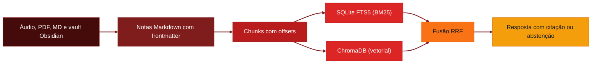

# 🧠 Escólio

<p align="center">
  
  
  
  
</p>

<p align="center">
  
  
  
  
  
  
</p>

<p align="left">
  <strong>Transforme áudios, PDFs e anotações em conhecimento pesquisável, com resposta citada na fonte.</strong><br />
  Sistema desktop local-first para captura, estruturação em Markdown e recuperação semântica de conhecimento pessoal em português brasileiro.
</p>


> Antes chamado **free-plaud**. O nome mudou, o objetivo continua o mesmo: guardar o que você aprendeu sem depender de disciplina manual para organizar.

---

## Visão geral

**Escólio** é um pipeline privado que pega o material que você já produz e o transforma em notas que você consegue consultar depois.

O fluxo principal:

1. **Captura** textos (`.txt`, `.md`, `.pdf`), vaults do Obsidian e gravações do microfone, com transcrição local via `faster-whisper`
2. **Estruturação** do conteúdo em notas Markdown canônicas, com frontmatter
3. **Indexação** em trechos (chunks) com offsets de caractere, gravados em SQLite FTS5 (BM25) e ChromaDB (vetorial)
4. **Pergunta** respondida por busca híbrida com fusão RRF, sempre com a passagem de origem. Se não houver evidência suficiente, o sistema se abstém e não inventa resposta

O foco é a rastreabilidade: cada resposta aponta para o trecho exato da nota que a sustenta.

---

## Demo

<p align="center">
  
</p>

<p align="center">
  <br />
  <sub>Tela de perguntas: a resposta aponta para o trecho da nota que a sustenta.</sub>
</p>

---

## Fluxo



---

## Para quem é

- Estudantes que acumulam aulas, PDFs e anotações e querem achar o que já estudaram
- Profissionais que registram reuniões e atas e precisam consultar decisões antigas
- Quem não quer enviar seus documentos para a nuvem por padrão
- Quem estuda RAG local-first e quer um exemplo de pipeline com citação obrigatória e abstenção

---

## Stack

- **Python 3.12 + uv** para o backend e o gerenciamento de dependências
- **Typer** para a CLI e **Textual** para a interface de terminal (TUI)
- **Pydantic** para configuração e contratos de dados
- **SQLite FTS5** para busca lexical com BM25
- **ChromaDB** para busca vetorial, com embedding padrão `chroma-default` e opcional `paraphrase-multilingual-MiniLM-L12-v2` via sentence-transformers
- **faster-whisper** e **Silero VAD (ONNX)** para transcrição e detecção de voz
- **React 19 + TypeScript + Vite** para a interface gráfica
- **PyWebView** (Edge WebView2) para empacotar a interface como app desktop
- **Vitest, Playwright e pytest** para testes; **Ruff** e **ESLint** para lint
- **GitHub Actions** com quality gate, SonarCloud e release do `.exe` em tags `v*`

---

## Pré-requisitos

*   [x] **Windows 10/11 com PowerShell** - o launcher `es.ps1` é o caminho principal (há `es` para Linux, macOS e WSL)
*   [x] **Python 3.12** e **[uv](https://docs.astral.sh/uv/)** - gerenciam o ambiente do backend
*   [x] **Node.js 22** e **npm** - compilam a interface React
*   [x] **Microsoft Edge WebView2** - necessário para abrir o app desktop
*   [ ] **Ollama** ou **LM Studio** (opcional) - para respostas com modelo local
*   [ ] **Chave de API de um provedor compatível com OpenAI** (opcional) - só se você optar por esse provedor

---

## Configuração

### 1. Dependências

```powershell
cd pipeline
uv sync --extra cpu --extra audio
cd ..\UI
npm ci
```

Sem GPU NVIDIA, `--extra cpu` é o caminho certo. Para PyTorch com CUDA 12.8, use `--extra gpu-cu128` (os extras `cpu` e `gpu-cu128` são excludentes).

### 2. Variáveis de ambiente

Crie `pipeline/.env` (ele já está fora do Git). Todas as variáveis usam o prefixo `ESCOLIO_`. Valores antigos `FREE_PLAUD_*` continuam aceitos como fallback.

| Variável | Descrição | Exemplo |
|---|---|---|
| `ESCOLIO_ANSWER_PROVIDER` | Quem escreve a resposta: `extractive` (padrão), `ollama`, `lmstudio` ou `openai-compatible` | `ollama` |
| `ESCOLIO_ANSWER_MODEL` | Modelo usado pelo provedor escolhido | `qwen2.5:3b` |
| `ESCOLIO_ANSWER_BASE_URL` | Endereço do provedor (opcional para Ollama e LM Studio) | `http://localhost:11434` |
| `ESCOLIO_ANSWER_API_KEY` | Chave do provedor remoto (BYOK). Guarde só no `.env` local | `sua-chave` |
| `ESCOLIO_EMBEDDING_MODEL` | `chroma-default` (padrão) ou `sentence-transformer:<modelo>` | `sentence-transformer:sentence-transformers/paraphrase-multilingual-MiniLM-L12-v2` |
| `ESCOLIO_EMBEDDING_DEVICE` | Dispositivo do embedding: `cpu`, `cuda` ou `auto` | `cpu` |

Sem nenhuma configuração, as respostas são **extrativas**: o texto sai das passagens encontradas, sem chamar modelo nenhum.

### 3. Testar

```powershell
.\es.ps1 doctor
.\es.ps1 test
```

`doctor` mostra o estado do ambiente (FTS5, modelo de embedding, provedor de resposta e áudio) antes de você indexar algo grande.

---

## Uso

### Fluxo diário

1. Abra o app com `.\es.ps1 app`
2. Adicione a pasta ou os arquivos que quer consultar. Para indexar uma pasta pela linha de comando:
   ```powershell
   cd pipeline
   uv run escolio corpus rebuild "D:\caminho\pasta" --recursive --yes
   ```
3. Faça a pergunta na aba de chat. A resposta traz as passagens de origem
4. Se o sistema disser que não encontrou evidência, reformule a pergunta ou adicione a fonte que falta
5. Para trabalhar no terminal, use `.\es.ps1 tui` ou `.\es.ps1 menu`

### Exemplo

```bash
cd pipeline
uv run escolio corpus ask --question "Qual foi a decisão sobre o cache do catálogo?" --strategy hybrid --top-k 6
```

### Gerar o executável

```powershell
.\es.ps1 release
```

O comando gera `UI/dist/AssistenteIA` e o pacote `AssistenteIA-windows-x64.zip` na raiz. A release automática no GitHub sai de uma tag `v*`.

### O que fazer depois

- Conferir a [arquitetura do backend](./docs/arquitetura/Arquitetura_Backend.md) antes de mexer no pipeline de busca
- Ler o [experimento de calibração do RRF](./docs/experimentos/15_calibracao_rrf_tcc.md) para entender os limiares de abstenção
- Acompanhar o histórico em [`Sprints/STATUS.md`](./Sprints/STATUS.md)

---

## Estrutura do projeto

```text
tcc-free-plaud/
├── pipeline/
│   └── src/escolio/      # Backend Python 3.12
│       ├── app/          # Configuração Pydantic, doctor e serviço de áudio
│       ├── ingest/       # Extratores PDF/TXT/MD, cleaner do Obsidian, watcher e áudio
│       ├── notes/        # Estruturação canônica e repositório de notas
│       ├── retrieval/    # Chunking, BM25, busca vetorial e fusão RRF
│       ├── providers/    # Whisper, Silero VAD, embeddings e provedores de resposta
│       ├── storage/      # SQLite FTS5 e ChromaDB
│       ├── corpus/       # Runtime do corpus, ask e jobs de indexação
│       ├── benchmark/    # Avaliação experimental (MRR, Recall@k, latência)
│       └── tui/          # Interface Textual
├── UI/                   # Frontend React 19 + TypeScript + PyWebView
│   ├── src/              # Componentes, contextos e serviços
│   ├── e2e/              # Testes Playwright
│   └── main.py           # Entrypoint do app desktop
├── docs/                 # Arquitetura, experimentos, planejamento e monografia
├── Sprints/              # Histórico das sprints
├── scripts/              # Build do desktop e ferramentas da esteira
├── .github/workflows/    # quality-gate.yml e desktop-release.yml
├── es.ps1                # Launcher PowerShell
├── es                    # Launcher bash (Linux, macOS, WSL)
└── README.md
```

---

## Contribuindo

Contribuições são bem-vindas!

1. Faça um fork do repositório
2. Crie uma branch: `git checkout -b feature/sua-feature`
3. Rode `.\es.ps1 test` antes de commitar
4. Commit suas alterações: `git commit -m "feat: minha contribuição"`
5. Push da branch: `git push origin feature/sua-feature`
6. Abra um Pull Request com um resumo das alterações

Use [Conventional Commits](https://www.conventionalcommits.org/): `feat:`, `fix:`, `docs:`, `style:`, `refactor:`, `test:`, `chore:`.

A esteira do PR roda Security audit, Lint, Tests & ratchet e Build & smoke, além de SonarCloud (informativo, não reprova o PR) e um relatório fixo no PR. O job de imagem Docker é pulado porque o projeto não tem Dockerfile.

---

## Licença

Este projeto está sob a licença **MIT**. Veja o arquivo [LICENSE](./LICENSE) para detalhes.

---

<p align="center">
  Desenvolvido com ☕ por <a href="https://github.com/devAndreotti">devAndreotti</a>
</p>
