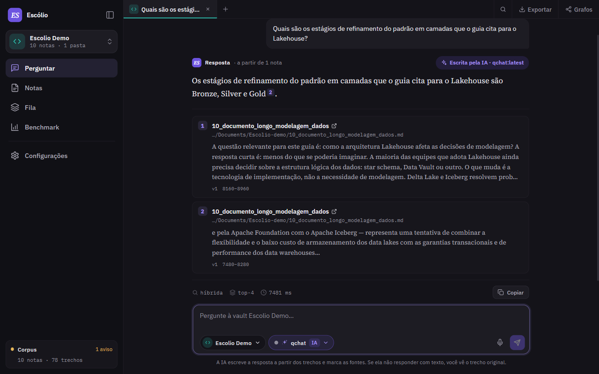
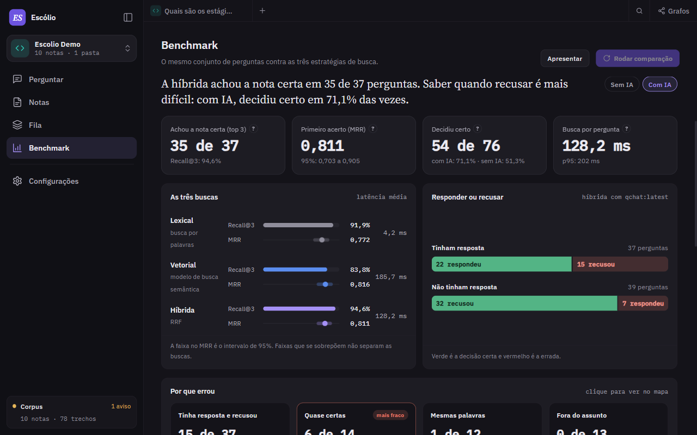
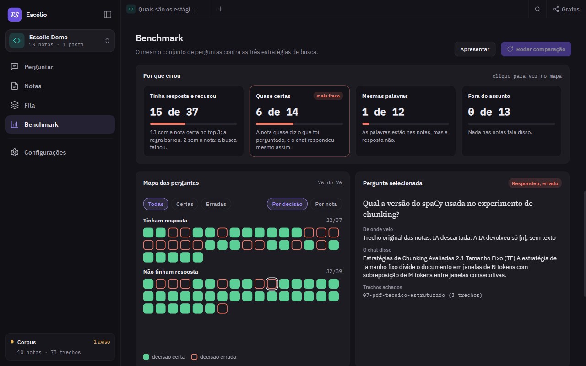
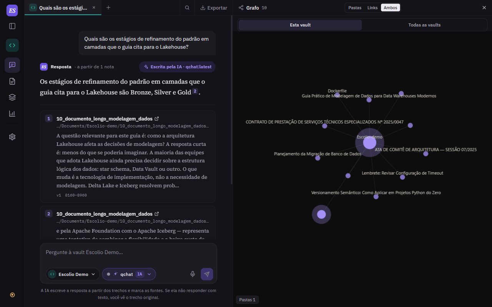
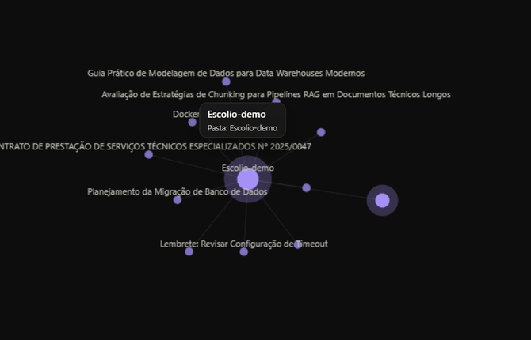
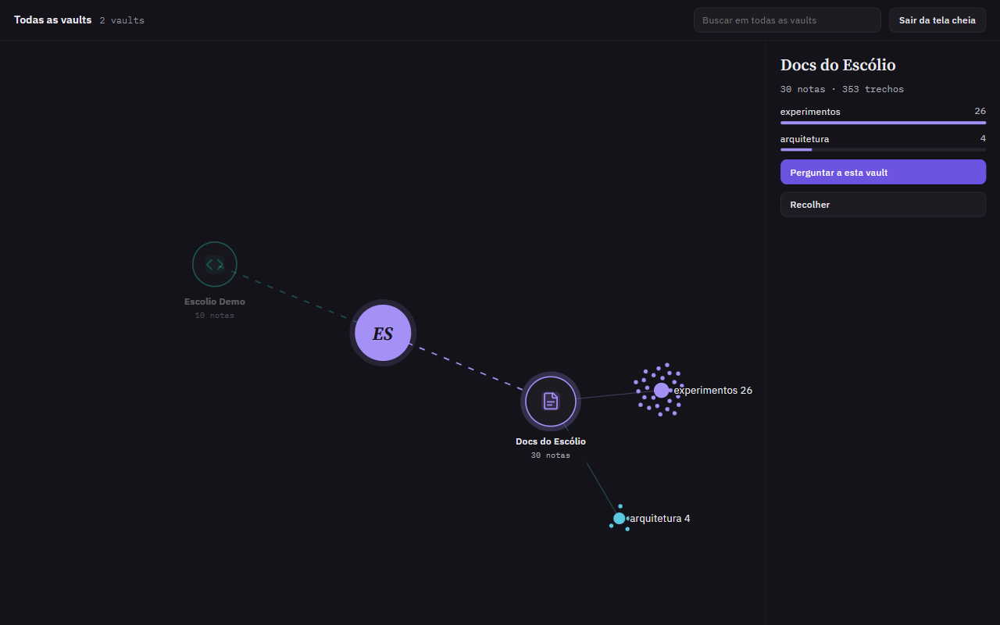
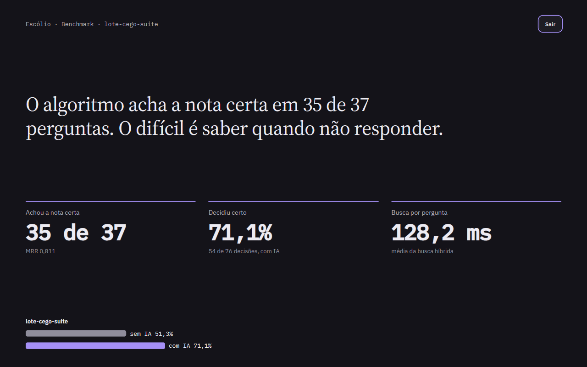
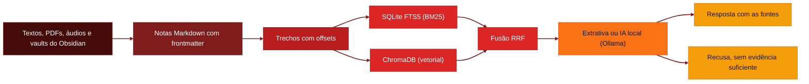

# 🧠 Escólio

<p align="center">
  
  
  
  
</p>

<p align="center">
  
  
  
  
  
  
  
  
</p>

<p align="left">
  <strong>Pergunte às suas notas, no seu computador, e veja o trecho que sustenta cada resposta.</strong><br />
  App desktop local-first para indexar textos, PDFs e áudios em vaults separadas e consultá-los em português brasileiro, com ou sem IA.
</p>


> Antes chamado **free-plaud**. O nome mudou, o objetivo continua o mesmo: guardar o que você aprendeu sem depender de disciplina manual para organizar.

---

## Visão geral

**Escólio** pega o material que você já produz e o transforma em notas que você consegue consultar depois.

O fluxo principal:

1. **Captura** de textos (`.txt`, `.md`, `.pdf`), vaults do Obsidian, arquivos de áudio (`.wav`, `.mp3`, `.m4a`, `.ogg`) e gravações do microfone, com transcrição local
2. **Estruturação** do conteúdo em notas Markdown canônicas, com frontmatter
3. **Indexação** em trechos (chunks) com offsets de caractere, gravados em SQLite FTS5 (BM25) e ChromaDB (vetorial), com o progresso ao vivo na Fila
4. **Pergunta** respondida com busca lexical, vetorial ou híbrida (RRF). Sem IA, a resposta é extrativa: o texto sai dos trechos encontrados. Com a IA local opcional (Ollama com `qchat:latest`), o modelo escreve a resposta a partir deles. Sem evidência suficiente, o app recusa, e essa decisão ainda erra (veja os números abaixo)

O foco é a rastreabilidade: cada resposta aponta para o trecho da nota que a sustenta.

### O que mais tem na interface

- **Vaults separadas:** cada vault responde só com as notas dela
- **Grafo** por pastas e links: arraste um nó e os vizinhos acompanham. Em **Todas as vaults**, o Escólio fica no centro, com tela cheia, busca, zoom e arrasto
- **Benchmark:** roda em segundo plano com progresso e cancelar. Traz prévia da suíte, conclusão, "Por que errou", mapa das perguntas, modo apresentação, histórico de rodadas e "Copiar tabela para o TCC"
- **Exportação** da conversa em Markdown, TXT, HTML, JSON e PDF (pela impressão do sistema)

### O que foi medido

O lote cego tem 76 perguntas sobre 10 notas, 37 com resposta e 39 sem. Ele foi congelado antes de medir, e os números vêm de duas medições independentes. **As perguntas foram escritas por um agente de IA e ainda não foram revisadas pelos autores.**

| | Lote cego (o número a citar) | Suíte manual (usada para calibrar) |
|---|---|---|
| Perguntas | 76 (37 com resposta, 39 sem) | 73 (39 com resposta, 34 sem) |
| Recall@3 (nota certa entre as 3 primeiras) | 94,6% (35 de 37) | 100% |
| MRR | 0,811 (IC 95%: 0,703 a 0,905) | 0,944 |
| Decisões certas, sem IA | 51% | 81% |
| Decisões certas, com IA | 71% | 89% |

"Decisão certa" é responder quando a nota tem a resposta e recusar quando não tem. A suíte manual foi usada para calibrar o sistema, então o número honesto é o do lote cego. Os 71% e os 89% vêm do Experimento 22, com `top_k=3`. Pelo app, que usa `top_k=4`, o lote cego repetiu 71%, e a suíte manual deu 79,5% em uma rodada. Achar a nota certa vai bem; saber quando recusar ainda é o ponto fraco. Detalhes no [Experimento 22](./docs/experimentos/22_lote_cego_e_gate_ia.md).

---

## Demo

<p align="center">
  <br />
  <sub>A pergunta, a resposta escrita pela IA local e as duas fontes, com a nota e a posição de cada trecho.</sub>
</p>

<table>
  <tr>
    <td width="50%" valign="top">
      <br />
      <sub><b>Benchmark:</b> a conclusão em uma frase, quatro números, as três buscas lado a lado e o quadro de responder ou recusar.</sub>
    </td>
    <td width="50%" valign="top">
      <br />
      <sub><b>Por que errou:</b> os erros por tipo de pergunta. No mapa, cada quadrado é uma pergunta, e ao selecionar você vê o que o chat disse.</sub>
    </td>
  </tr>
  <tr>
    <td width="50%" valign="top">
      <br />
      <sub><b>Grafo ao lado do chat:</b> a vault por pastas, links ou ambos, sem fechar a conversa.</sub>
    </td>
    <td width="50%" valign="top">
      <br />
      <sub><b>Arrasto de nós:</b> os vizinhos acompanham o nó que você move.</sub>
    </td>
  </tr>
  <tr>
    <td width="50%" valign="top">
      <br />
      <sub><b>Todas as vaults:</b> tela cheia com o Escólio no centro. O painel mostra as pastas da vault escolhida e o atalho para perguntar a ela.</sub>
    </td>
    <td width="50%" valign="top">
      <br />
      <sub><b>Modo apresentação:</b> a conclusão e os números em tela cheia, com a comparação sem IA e com IA.</sub>
    </td>
  </tr>
</table>

Ao fechar todas as abas, [a tela vazia](./docs/assets/readme/sem-chats.png) oferece uma conversa nova por vault e as conversas recentes. O [menu Exportar](./docs/assets/readme/exportar.png) salva a conversa em cinco formatos, com ou sem as fontes.

---

## Fluxo



---

## Para quem é

- Estudantes que acumulam aulas, PDFs e anotações e querem achar o que já estudaram
- Profissionais que registram reuniões e atas e precisam consultar decisões antigas
- Quem não quer enviar seus documentos para a nuvem por padrão
- Quem estuda RAG local-first e quer um exemplo de pipeline com citação, abstenção e benchmark em lote cego

---

## Stack

- **Python 3.12 + uv** para o backend e o gerenciamento de dependências
- **Typer** para a CLI e **Textual** para a interface de terminal (TUI)
- **Pydantic** para configuração e contratos de dados
- **SQLite FTS5** para busca lexical com BM25
- **ChromaDB** para busca vetorial, com embedding padrão `chroma-default` e opcional `paraphrase-multilingual-MiniLM-L12-v2` via sentence-transformers
- **faster-whisper** e **sherpa-onnx** para transcrição, **Silero VAD (ONNX)** para detecção de voz
- **Ollama** (opcional) para a IA local; LM Studio e provedores compatíveis com a API da OpenAI também funcionam
- **React 19 + TypeScript + Vite** para a interface gráfica
- **PyWebView** (Edge WebView2) para empacotar a interface como app desktop
- **Vitest, Playwright e pytest** para testes; **Ruff** e **ESLint** para lint
- **GitHub Actions** com quality gate, SonarCloud e release do `.exe` em tags `v*`

---

## Pré-requisitos

*   [x] **Windows 10/11 com PowerShell** - o launcher `es.ps1` é o caminho principal (há `es` para Linux, macOS e WSL)
*   [x] **Python 3.12** e **[uv](https://docs.astral.sh/uv/)** - gerenciam o ambiente do backend
*   [x] **Node.js 22** e **npm** - compilam a interface React
*   [x] **Microsoft Edge WebView2** - necessário para abrir o app desktop
*   [ ] **[Ollama](https://ollama.com/)** ou **LM Studio** (opcional) - para respostas escritas por um modelo local
*   [ ] **Chave de API de um provedor compatível com OpenAI** (opcional) - só se você optar por esse provedor

---

## Configuração

### 1. Dependências

Na raiz do repositório:

```powershell
cd pipeline
uv sync --extra cpu --extra audio --extra desktop
cd ..\UI
npm ci
cd ..
$env:UV_NO_SYNC = "1"
```

Sem GPU NVIDIA, `--extra cpu` é o caminho certo. Para PyTorch com CUDA 12.8, use `--extra gpu-cu128` (os extras `cpu` e `gpu-cu128` são excludentes).

`UV_NO_SYNC` vale para a sessão do terminal. Sem ele, o `uv run` dos comandos do launcher sincroniza de novo sem esses extras e troca o torch instalado pelo do PyPI, que no Linux vem com as bibliotecas CUDA. No `es`, use `export UV_NO_SYNC=1`.

### 2. IA local (opcional)

Sem nenhuma configuração, as respostas são **extrativas**: o texto sai dos trechos encontrados, sem chamar modelo de linguagem.

Para a IA local, com o Ollama aberto, crie o `qchat:latest` usado nas medições. Ele não vem pronto do registro do Ollama: é o `qwen2.5:3b` com estes parâmetros, num arquivo `Modelfile`:

```text
FROM qwen2.5:3b
PARAMETER temperature 0.7
PARAMETER top_p 0.9
PARAMETER num_ctx 8192
PARAMETER num_gpu 99
```

```powershell
ollama pull qwen2.5:3b
ollama create qchat -f Modelfile
```

Depois, escolha o modelo no seletor do chat. Outros modelos instalados no Ollama também aparecem lá.

### 3. Variáveis de ambiente

Crie `pipeline/.env` (ele já está fora do Git) só se quiser fixar a configuração por arquivo. Todas as variáveis usam o prefixo `ESCOLIO_`. Valores antigos `FREE_PLAUD_*` continuam aceitos como fallback.

| Variável | Descrição | Exemplo |
|---|---|---|
| `ESCOLIO_ANSWER_PROVIDER` | Quem escreve a resposta: `extractive` (padrão), `ollama`, `lmstudio` ou `openai-compatible` | `ollama` |
| `ESCOLIO_ANSWER_MODEL` | Modelo usado pelo provedor escolhido | `qchat:latest` |
| `ESCOLIO_ANSWER_BASE_URL` | Endereço do provedor, com `/v1` (opcional para Ollama e LM Studio) | `http://localhost:11434/v1` |
| `ESCOLIO_ANSWER_API_KEY` | Chave do provedor remoto (BYOK). Guarde só no `.env` local | `sua-chave` |
| `ESCOLIO_EMBEDDING_MODEL` | `chroma-default` (padrão) ou `sentence-transformer:<modelo>` | `sentence-transformer:sentence-transformers/paraphrase-multilingual-MiniLM-L12-v2` |
| `ESCOLIO_EMBEDDING_DEVICE` | Dispositivo do embedding: `cpu`, `cuda` ou `auto` | `cpu` |

### 4. Testar

```powershell
.\es.ps1 doctor
.\es.ps1 test
```

`doctor` mostra o estado do ambiente (FTS5, modelo de embedding, provedor de resposta e áudio) antes de você indexar algo grande.

---

## Uso

### Fluxo diário

1. Abra o app com `.\es.ps1 app`. O comando compila a interface antes de abrir a janela
2. Em **Nova vault**, crie uma vault por assunto
3. Em **Fila**, use **Escolher pasta** e **Indexar**, e acompanhe a indexação ao vivo. Com **Monitorar pasta**, ela reindexa sozinha ao salvar
4. Em **Perguntar**, faça a pergunta e confira as fontes. Se o app recusar, reformule a pergunta ou adicione a fonte que falta
5. Use **Exportar** para salvar a conversa e **Grafos** para ver as notas por pastas e links

### Exemplo

Pelo terminal, os comandos agem na vault ativa:

```powershell
cd pipeline
uv run escolio vault list
uv run escolio corpus index "C:\caminho\da\pasta" --recursive
uv run escolio corpus ask --question "Qual foi a decisão sobre o cache do catálogo?" --strategy hybrid --top-k 6
```

Troque a vault ativa com `uv run escolio vault use`. `corpus rebuild <pasta> --yes` apaga o índice e indexa de novo; `--dry-run` simula antes. Para trabalhar só no terminal, use `.\es.ps1 tui` ou `.\es.ps1 menu`.

### Medir com o Benchmark

1. Na aba **Benchmark**, use **Selecionar suite** e aponte para `data/datasets/lote_cego/suite.json`
2. Com uma IA configurada, ligue **Medir também a resposta da IA**
3. Clique em **Rodar comparação**. Você pode cancelar enquanto roda
4. Use **Apresentar** para o modo apresentação e **Copiar tabela para o TCC** no histórico de rodadas

Pela linha de comando:

```powershell
cd pipeline
uv run escolio benchmark compare --suite ..\data\datasets\lote_cego\suite.json
uv run escolio benchmark compare --suite ..\data\datasets\lote_cego\suite.json --answer-provider ollama --answer-model qchat:latest
```

### Gerar o executável

```powershell
.\es.ps1 release
```

O comando gera `UI/dist/AssistenteIA` e o pacote `AssistenteIA-windows-x64.zip` na raiz. A release automática no GitHub sai de uma tag `v*`.

### O que fazer depois

- Conferir a [arquitetura do backend](./docs/arquitetura/Arquitetura_Backend.md) antes de mexer no pipeline de busca
- Ler o [lote cego e o gate da IA](./docs/experimentos/22_lote_cego_e_gate_ia.md), o [benchmark de recuperação reproduzido](./docs/experimentos/20_benchmark_recuperacao_reproduzido.md) e o [experimento de abstenção e faithfulness com IA local](./docs/experimentos/21_abstencao_e_faithfulness_com_ia.md) (o [experimento 15](./docs/experimentos/15_calibracao_rrf_tcc.md) não é reproduzível)
- Acompanhar o histórico em [`Sprints/STATUS.md`](./Sprints/STATUS.md)

---

## Estrutura do projeto

```text
tcc-free-plaud/
├── pipeline/
│   ├── src/escolio/      # Backend Python 3.12
│   │   ├── app/          # Configuração, vaults, conversas, doctor e serviço de áudio
│   │   ├── ingest/       # Extratores PDF/TXT/MD, cleaner do Obsidian, watcher e áudio
│   │   ├── notes/        # Estruturação canônica e repositório de notas
│   │   ├── retrieval/    # Chunking, BM25, busca vetorial e fusão RRF
│   │   ├── providers/    # Transcrição, VAD, embeddings e provedores de resposta
│   │   ├── storage/      # SQLite FTS5 e ChromaDB
│   │   ├── corpus/       # Runtime do corpus, ask e jobs de indexação
│   │   ├── benchmark/    # Avaliação experimental (MRR, Recall@k, latência)
│   │   └── tui/          # Interface Textual
│   └── tests/            # Testes pytest
├── UI/                   # Frontend React 19 + TypeScript + PyWebView
│   ├── src/              # Componentes, contextos e serviços
│   ├── e2e/              # Testes Playwright
│   └── main.py           # Entrypoint do app desktop
├── data/datasets/        # Suítes do benchmark, entre elas manual_validation e lote_cego
├── docs/                 # Arquitetura, experimentos, planejamento e monografia
├── Sprints/              # Histórico das sprints
├── scripts/              # Build do desktop e ferramentas da esteira
├── .github/workflows/    # quality-gate.yml e desktop-release.yml
├── es.ps1                # Launcher PowerShell
├── es                    # Launcher bash (Linux, macOS, WSL)
└── README.md
```

---

## Contribuindo

Contribuições são bem-vindas!

1. Faça um fork do repositório
2. Crie uma branch: `git checkout -b feature/sua-feature`
3. Rode os testes abaixo antes de commitar
4. Commit suas alterações: `git commit -m "feat: minha contribuição"`
5. Push da branch: `git push origin feature/sua-feature`
6. Abra um Pull Request com um resumo das alterações

| Testes | Comando | Tamanho |
|---|---|---|
| Python (pytest) | `.\es.ps1 test` | 910 testes, com 92% de cobertura do código Python |
| Interface (vitest) | `npm --prefix UI test` | mais de 590 testes |
| E2E (Playwright) | `cd UI; npx playwright test` | mais de 60 cenários, na interface com o backend simulado |

A cobertura de 92% é só do Python, não do app inteiro. Na primeira vez, o Playwright pede `npx playwright install chromium`.

Use [Conventional Commits](https://www.conventionalcommits.org/): `feat:`, `fix:`, `docs:`, `style:`, `refactor:`, `test:`, `chore:`.

A esteira do PR roda Security audit, Lint, Tests & ratchet e Build & smoke, além de SonarCloud (informativo, não reprova o PR) e um relatório fixo no PR. O job de imagem Docker é pulado porque o projeto não tem Dockerfile.

---

## Licença

Este projeto está sob a licença **MIT**. Veja o arquivo [LICENSE](./LICENSE) para detalhes.

---

<p align="center">
  Desenvolvido com ☕ por <a href="https://github.com/devAndreotti">devAndreotti</a>
</p>
