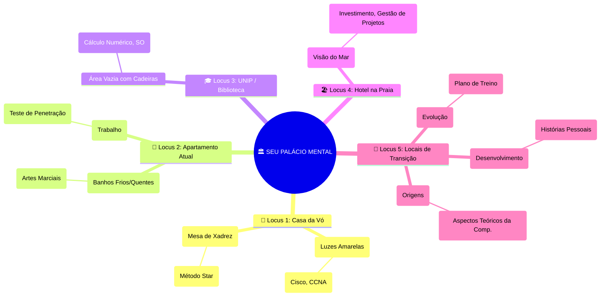

> [!info] 📖 **Sobre este Registro**  
> **Natureza:** Guia de aplicação prática da técnica mnemônica do Palácio Mental.  
> **Objetivo:** Mapear memórias pessoais e sensoriais do usuário para organizar e memorizar notas de estudo no Obsidian.  
> **Abordagem:** Integração da filosofia do "Sótão Mental" de Sherlock Holmes com a estrutura de Loci (lugares) detalhados.

# 🏛️ O Palácio Mental de Sherlock Holmes: Guia de Maestria

O **Palácio da Memória**, ou **Método Loci**, é a arte de transformar o espaço físico em um mapa mental para o conhecimento. Ao invés de apenas armazenar informações, você as **ancora** em locais familiares, usando a memória espacial e sensorial para a recuperação.

## 1. A Filosofia do "Sótão Mental" (Brain Attic)

Antes de construir o Palácio, é fundamental adotar a mentalidade de **seleção** de informações, algo que o Sherlock Holmes original chamava de **Sótão Mental** (*Brain Attic*).

> "Considero que o cérebro de um homem, originalmente, é como um pequeno sótão vazio, e você tem que estocá-lo com a mobília que escolher. Um tolo apanha todo o tipo de tralha que encontra, de modo que o conhecimento que poderia ser útil é empilhado ou, na melhor das hipóteses, misturado com outras coisas, de tal forma que ele tem dificuldade em encontrá-lo. O homem habilidoso, por outro lado, seleciona cuidadosamente o que coloca em seu Sótão Mental."

A distinção é clara: o **Sótão Mental** é a sua filosofia de organização (o que guardar), e o **Palácio Mental** é a sua técnica de recuperação (onde guardar).

| Conceito | Foco Principal | Aplicação no Obsidian |
| :--- | :--- | :--- |
| **Sótão Mental** | **Seleção e Organização** | O que *deve* ser anotado. Filtragem de informações e estrutura de pastas/tags. |
| **Palácio Mental** | **Associação e Recuperação** | *Onde* a informação deve ser armazenada. Mapeamento de notas para locais. |

## 2. Seu Palácio Pessoal: Mapeamento Sensorial e Estrutural

A força do seu Palácio reside na riqueza dos detalhes sensoriais. Cada cômodo (sub-locus) deve evocar uma memória forte para servir como âncora mnemônica.

### Locus Principal 1: 🏡 Casa da Vó (Fundamentos e Estratégia)

| Cômodo (Sub-Locus) | Descrição Sensorial                                                                                         | Assunto Atribuído (Mobília)                                                     | Justificativa Mnemônica                                                          |
| :----------------- | :---------------------------------------------------------------------------------------------------------- | :------------------------------------------------------------------------------ | :------------------------------------------------------------------------------- |
| **Sala de Estar**  | Luzes amarelas, época de Natal, calmaria. (**Conforto** e **Tradição**).                                    | **Conceitos Fundamentais de TI** (Cisco, CCNA, Conceitos)                       | A base, a **tradição** do conhecimento. O conforto para aprender o básico.       |
| **Copa**           | Mesa velha, cadeiras, cheiro de madeira, jogar cartas/xadrez com o avô. (**Estratégia** e **Imutabilidade** | **Métodos e Estratégias** (Método Star, Aprendizado em Camadas, Guia Essencial) | O local da **estratégia** (xadrez) e da base **imutável** (a copa que não muda). |

### Locus Principal 2: 🏢 Apartamento Atual em Sorocaba (Rotina e Aplicação)

| Cômodo (Sub-Locus) | Descrição Sensorial                                                       | Assunto Atribuído (Mobília)                                    | Justificativa Mnemônica                                                     |
| :----------------- | :------------------------------------------------------------------------ | :------------------------------------------------------------- | :-------------------------------------------------------------------------- |
| **Banheiro**       | Banhos frios no calor, quentes no frio. (**Disciplina** e **Adaptação**). | **Artes Marciais** (Jiu-jitsu, Muay Thai, Krav Maga)           | Foco na **disciplina** do treino e na **adaptação** do corpo ao frio/calor. |
| **Quarto**         | Seu ambiente de **Trabalho** e **Vida Diária**.                           | **Área de TI** (Gerenciamento de Ameaças, Teste de Penetração) | Seu ambiente de **aplicação prática** imediata e trabalho.                  |

### Locus Principal 3: 🎓 UNIP / Biblioteca (Estudo Profundo)

| Cômodo (Sub-Locus) | Descrição Sensorial | Assunto Atribuído (Mobília) | Justificativa Mnemônica |
| :--- | :--- | :--- | :--- |
| **Biblioteca** | Silêncio, cheiro de livro, escadas. (**Estudo Profundo**). | **Estudos de Faculdade** (Cálculo Numérico, Comp. Gráfica, SO) | O local de **estudo acadêmico** e pesquisa formal. |

### Locus Principal 4: 🏖️ Hotel na Praia (Visão Ampla e Planejamento)

| Cômodo (Sub-Locus) | Descrição Sensorial                                                                            | Assunto Atribuído (Mobília)                                                                               | Justificativa Mnemônica                                            |
| :----------------- | :--------------------------------------------------------------------------------------------- | :-------------------------------------------------------------------------------------------------------- | :----------------------------------------------------------------- |
| **Quarto/Varanda** | Frente para o mar (Litoral de SP), calmaria, cama enorme. (**Visão Ampla** e **Relaxamento**). | **Investimento e Estratégias de Projeto** (Gestão de Projetos, Investimento, Estratégias para Lançar App) | O local de **visão ampla** (o mar) e calma para planejar o futuro. |

### Locus Principal 5: 🌳 Locais de Transição e Reflexão

| Locus | Descrição Sensorial | Assunto Atribuído (Mobília) | Justificativa Mnemônica |
| :--- | :--- | :--- | :--- |
| **Parque das Águas** | Começou a correr lá, hoje treina em academia. (**Transição** e **Evolução**). | **Plano de Treino e Saúde** (Rotina de exercícios, dieta, evolução física) | O local do **início** da jornada de saúde e da **evolução** da rotina. |
| **Praça Pio XII** | Ponto de ônibus, casulos de lagartas. (**Desenvolvimento** e **História**). | **Histórias Pessoais** (Amor pela Programação, Por que Emagreci, etc.) | O local de **transição** (ônibus) e **desenvolvimento** (casulos). |
| **Casa Antiga (SJC)** | Formigueiros, infância. (**Origens**). | **Conceitos** (Conceitos Teóricos, Aspectos Teóricos da Computação) | O local das **origens** e dos **fundamentos** mais antigos. |

## 3. Visualizando a Estrutura do Palácio (Gráfico Mermaid)

Este **Mapa Mental** (Mindmap) representa a hierarquia do seu Palácio Mental de forma visual e intuitiva. Você pode usá-lo no Obsidian para ter uma visão geral da sua estrutura de conhecimento, simulando o "tour" mental.

**Dica:** No Obsidian, você pode clicar no mapa mental para expandir e recolher os ramos, facilitando a navegação mental.

## 4. Próximos Passos e Dicas de Implementação

1.  **Crie as Notas de Locus**: Crie uma nota para cada Locus Principal (ex: `1. Casa da Vó`) e para cada Cômodo (ex: `1.1. Cozinha`). Use o emoji correspondente no título.
2.  **Ancore as Notas de Estudo**: Mova ou crie *links* para suas notas de estudo (ex: `CCNA - Fundamentos de Rede`) dentro do Cômodo correspondente.
3.  **Use o Canvas para o Tour**: Crie um Canvas no Obsidian e use-o como um **"Tour Guiado"** pelo seu Palácio. Coloque as notas dos Cômodos em ordem sequencial para simular o passeio mental.
4.  **Reforço Sensorial**: Ao revisar uma nota (ex: `Método Star`), feche os olhos por um segundo e imagine-se na **Cozinha da Vó**, sentindo o cheiro, tocando a mesa velha e jogando xadrez. Isso reforça a âncora mnemônica.

[[Casa da Vó]]