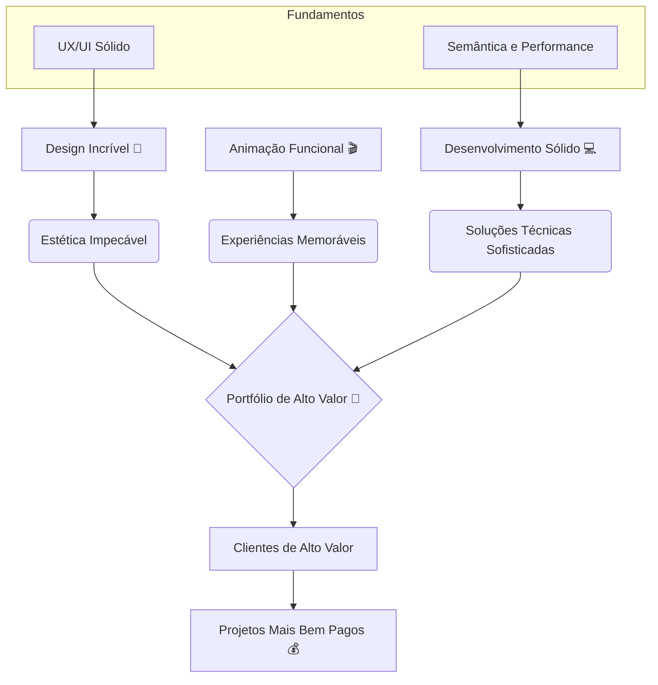

# 🚀 Guia Essencial para um Site de Alto Valor: Design, UX e Desenvolvimento

Este guia é um resumo estratégico das melhores práticas para criar sites que se destacam, focando em **Experiência do Usuário (UX)**, **Estética (UI)** e **Performance de Código**.

## 1. 🎯 O Foco Central: Experiência do Usuário (UX)

A **Experiência do Usuário (UX)** é o pilar de qualquer projeto de sucesso. Ela é a jornada completa do usuário, e não apenas a estética.

> 💡 **Lembrete (Questão 1):** UX trabalha a jornada completa do usuário 🗺️, enquanto UI cuida dos elementos visuais e pontos de interação da interface 🎨.

### 1.1. O Processo de Validação e Economia (Questão 8)

A prototipagem é crucial para evitar retrabalho e alinhar expectativas.

| Etapa | Ferramenta Principal | Objetivo | Vantagem Chave |
| :---: | :---: | :--- | :--- |
| **Design** | Figma | Criar o visual e a interação. | **Alinhamento Óptico:** Ajustar elementos para o que *parece* bom ao olho humano, mesmo que matematicamente incorreto. |
| **Prototipagem** | Figma | Simular a navegação e a usabilidade. | **Validar Ideias:** Testar usabilidade e evitar retrabalho custoso no código 💸. |
| **Desenvolvimento** | HTML/CSS/JS | Construir a solução final. | **Performance:** Garantir carregamento rápido e semântica correta. |

## 2. 🎨 Princípios de Design Visual e Estilização (UI)

O design visual deve ser intencional, guiando a atenção do usuário e transmitindo a personalidade correta.

### 2.1. Hierarquia e Espaçamento (Questões 3 e 4)

A clareza visual é alcançada através de regras consistentes.

*   **Hierarquia Visual:** É a combinação de **tamanho, peso, cor, contraste e posicionamento** para guiar a atenção do usuário 👁️. O elemento mais importante deve ser o mais proeminente.
*   **Consistência de Espaçamento:** Utilize uma **escala de espaçamento baseada em múltiplos** (ex: 4px, 8px, 16px, 32px). Isso cria um ritmo visual harmonioso e facilita a manutenção do CSS.

### 2.2. Tipografia Estratégica 🖋️

A escolha da fonte deve refletir a personalidade do projeto e garantir legibilidade.

| Uso da Fonte | Característica | Exemplo de Estilo | Regra de Ouro |
| :---: | :---: | :---: | :--- |
| **Corpo de Texto** | Alta legibilidade, neutra. | Times New Roman (Formal/Blog), Poppins (Descontraída). | Use apenas **duas famílias tipográficas** no máximo. |
| **Títulos/Destaque** | Estilizada, com personalidade. | Fontes *Display* ou *Script*. | **Uso Limitado e Estratégico** (Questão 2). |

> ⚠️ **Atenção:** Se o tema é infantil/cartoon (ex: "batata ptingless"), a fonte não pode ser séria como Times New Roman. A tipografia deve ser baseada no layout e na persona.

### 2.3. Gráficos Vetoriais e Estética Moderna ✨

**USAR VETOR (SVG)** é uma diretriz fundamental para a web moderna.

*   **Vantagem do Vetor (Questão 9):** Vetores são **escaláveis infinitamente sem perda de qualidade** 📈.
*   **Fluxo de Trabalho:** Crie o vetor no Figma e copie o código SVG diretamente para o projeto.
*   **Degradês (Questão 7):** Aplique **degradês sutis** com cores próximas no espectro. Degradês muito contrastantes dão a ideia de "coisa velha" 👵.
*   **Padrões e Blending:** Adicione **padrões** (*patterns*) em lugares vazios para enriquecer o design. Use **mesclagem** (*blending modes*) para combinar camadas ou cores.

## 3. 💻 Estrutura e Desenvolvimento Web

O código deve ser performático, semântico e modular.

### 3.1. Abordagens de Desenvolvimento (Questões 11, 12, 13)

| Abordagem | Ferramentas/Linguagens | Foco | Característica |
| :---: | :---: | :---: | :--- |
| **Estrutura** | HTML | Semântica correta dos elementos. | Base do conteúdo. |
| **Estilização** | **CSS** | Estilo visual, layout e responsividade. | Linguagem de folha de estilos. |
| **Interatividade** | **JavaScript** | Lógica dinâmica e interatividade. | Adiciona vida à página. |
| **Low Code** | Webflow, WordPress (com builders) | Redução da programação manual. | Plataformas visuais (Low Code / No Code). |

### 3.2. Performance e Carregamento ⚡

A otimização do carregamento é crucial para a experiência do usuário.

1.  **CSS Modular:** Dividir o CSS para carregar o **essencial primeiro** (acima da dobra).
2.  **JavaScript Assíncrono:** Usar o atributo `defer` no `<script>` para garantir que o JS carregue no fim, sem bloquear a renderização inicial.
3.  **Semântica HTML:** Manter boa semântica de itens HTML.

> ⚙️ **Conceito JS:** Uma **função** é uma máquina que faz uma ação (bloco de código reutilizável).

### 3.3. Grid Responsivo e Área Útil 📐

O uso de um sistema de grid (Questão 5) é essencial para consistência e responsividade.

| Dispositivo | Colunas | Vantagem |
| :---: | :---: | :--- |
| **Desktop (1920px)** | 12 Colunas | Consistência e Alinhamento. |
| **Tablet** | 8 Colunas | |
| **Celular** | 4 Colunas | |

> 🖥️ **Área Útil:** Lembre-se que em telas como 1920x1080, a área útil real é menor (ex: 1920x900) devido às barras do sistema operacional (Windows, macOS).

## 4. 🎬 Animação e Interatividade de Alto Nível

Animações funcionais guiam o usuário e criam uma narrativa (Questão 23).

### 4.1. Animação com ScrollTrigger (GSAP)

O uso de bibliotecas como GSAP com o plugin ScrollTrigger permite animações sofisticadas e performáticas.

*   **Propósito:** **Guiar atenção, melhorar UX e criar narrativa**.
*   **Função `scrub` (Questão 21):** **Vincula a animação à posição do scroll** 🔗.
    *   A animação de movimento só ocorre ao rolar a página.
    *   Ao voltar o scroll, a animação retrocede (*scroll lata volta*).

### 4.2. Efeitos Visuais com SVG e CSS

| Propriedade | Linguagem | Função | Uso em Animação |
| :---: | :---: | :---: | :--- |
| **`path`** | SVG | Desenha formas complexas via coordenadas. | Animação de desenho de linha. |
| **`textPath`** | SVG | Faz o texto seguir o trajeto de um `path`. | Efeitos tipográficos criativos. |
| **`clip-path`** | CSS | Cria máscaras que recortam elementos em formas específicas. | Transições e revelações de conteúdo. |

## 5. 💰 Fluxo de Trabalho e Valor Agregado

Profissionais que unem design e desenvolvimento entregam valor diferenciado (Questão 24).

### 5.1. Diagrama de Fluxo de Valor

Este diagrama ilustra como a combinação de habilidades leva a projetos de alto valor.

### 5.2. O Diferencial do Portfólio

Um portfólio que atrai clientes de alto valor demonstra:

1.  **Design Incrível:** Estética e alinhamento visual impecáveis.
2.  **Soluções Técnicas Sofisticadas:** Código limpo e performance otimizada.
3.  **Foco em Resultados:** Mostrar como o trabalho gerou valor.