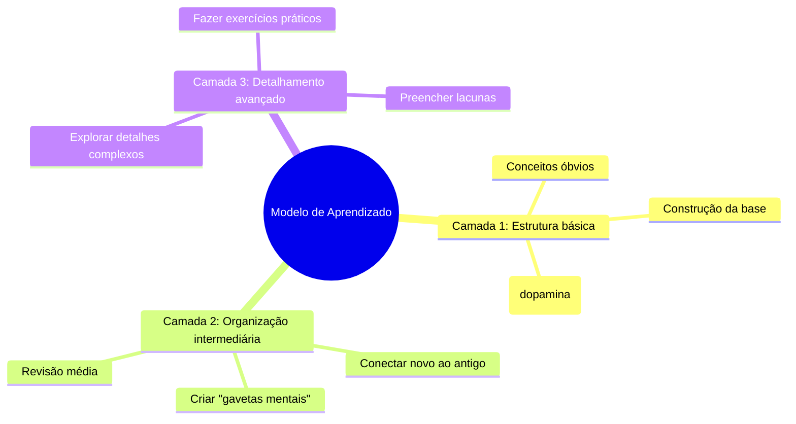

## 🗂️ Sumário

1. 🎯 Objetivo
    
2. 🧱 Problema (detalhado)
    
3. 🔎 Causas
    
4. 🧬 Conceito-chave: Reservatório de Dopamina
    
5. 🪜 Modelo de Camadas (Mermaid) ← _renderável no Obsidian_
    
6. 🛠️ Metodologia prática (3 fases)
	
7. ⚠️ Consequências se não aplicar
    
8. ✅ Checklist rápido

---

> [!warning] **Motivo / Por que isso importa**
> 
> - Estudar sem estrutura consome **até 20% a mais de esforço desnecessário**.
>     
> - Sem motivação, o ciclo de aprendizado quebra cedo — a dopamina é o **combustível** que mantém consistência.
>     

---

## 🧱 Problema (descrição detalhada)

> [!warning]
> 
> - Consumimos conteúdo (vídeos, leituras) mas não conseguimos **integrar**.
>     
> - Vídeo-aula **não é estudo**, é só entrada de dados.
>     
> - Informações soltas = ruído, sem aplicação real.
>     
> - Falta de estímulo gera desânimo e desistência precoce.
>     

---

## 🔎 Causas (explicação)

> [!note]
> 
> - **Base frágil**: tentar aprender o avançado sem consolidar o básico.
>     
> - **Sem gavetas mentais**: falta de categorias para guardar informações.
>     
> - **Excesso de dispersão**: múltiplos estímulos, sem foco.
>     
> - **Dificuldade desalinhada**: muito fácil (tédio) ou muito difícil (frustração).
>     
> - **Sobrecarga cognitiva**: pular camadas, não priorizar, leva ao burnout.
>     

---

## 🧬 Conceito-chave: Reservatório de Dopamina

> [!important]  
> A motivação não depende só de força de vontade — ela pode ser **engenheirada**.
> 
> Estratégias para manter o reservatório cheio:
> 
> - Quebrar aprendizado em **pequenas vitórias**.
>     
> - Celebrar microprogressos.
>     
> - Alternar esforço ↔ descanso.
>     
> - Estabelecer **metas claras e específicas**.
>     

---

## 🪜 Modelo de Camadas (Mermaid)

> [!tip] Integração
> 
> - **Camada 1** alimenta o **reservatório de dopamina**.
>     
> - **Camada 2** organiza e conecta.
>     
> - **Camada 3** aprofunda com prática real.
>     

---

## 🛠️ Metodologia prática (3 fases)

|Fase|Tempo sugerido|Ação prática|
|---|--:|---|
|**1 Estrutura**|~15 min|Assista/Leia algo fácil. Liste o que já sabe + dúvidas. Celebre microvitória.|
|**2 Organização**|40~45 min|Crie “gavetas” (tags/mapas mentais). Relacione novo ↔ velho.|
|**3 Detalhes**|Variável|Resolva exercícios, implemente exemplos, aplique em mini-projeto.|

---

## ⚠️ Consequências impactantes (se não aplicar)

> [!warning]
> 
> - Revisar infinitamente sem progresso.
>     
> - Baixa retenção.
>     
> - Desmotivação e desistência.
>     
> - Sensação de incapacidade.
>     

---

## ✅ Checklist rápido

> [!tip]
> 
> - Liste 3 coisas que já sabe do tema.
>     
> - Estude 15 min de algo fácil.
>     
> - Crie 2 gavetas mentais (“Fundamentos”, “Padrões”).
>     
> - Revise em 7 dias.
>     
> - Aplique em mini-projeto (1–2h).
>     

---

Quer que eu deixe esse resumo já formatado em **bloco Markdown limpo** (sem as minhas explicações) para você colar direto no Obsidian?