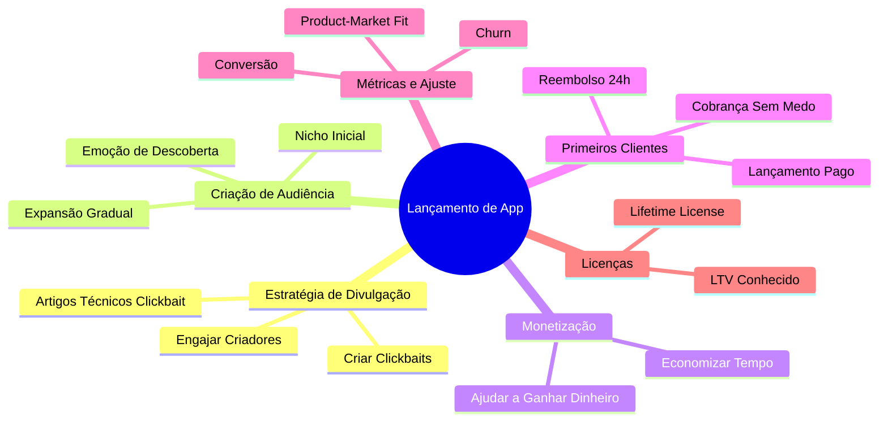
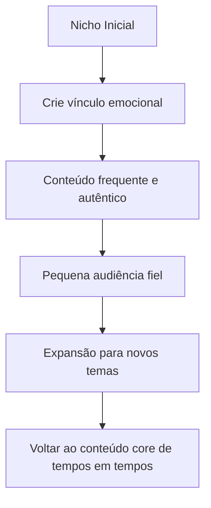
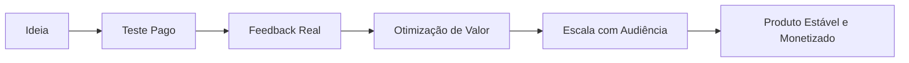
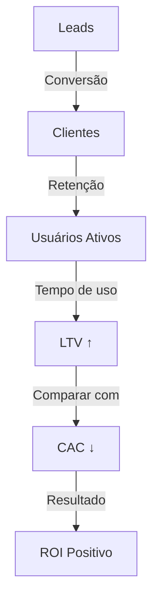

> Guia prático e mental map sobre como lançar, promover, monetizar e ajustar um aplicativo com foco em engajamento e fit de mercado.

---

## 🧭 Visão Geral

---

## 🎯 Estratégia de Lançamento e Divulgação

### 🧨 Criar Clickbaits Estratégicos

- Use títulos provocativos e curiosos.
    
- O objetivo não é enganar, mas **gerar curiosidade autêntica**.
    
- Exemplo: _"O app que me expulsaria da faculdade se eu mostrasse isso..."_
    

### 🐦 Twitter como Canal de Engajamento

|Ação|Descrição|Dica|
|---|---|---|
|Criar threads|Conte histórias, mostre aprendizados, erros e bastidores|Use linguagem natural e provocante|
|Engajar criadores|Envolva perfis com audiência (sem pedir favor)|Use DMs estratégicas e colaborações|
|Gerar polêmica leve|Humor + insights técnicos|Exemplo: “Como consegui ROI de 10x com um bug”|

### ✍️ Escrever Artigos Clickbait

- Produza artigos técnicos **com títulos virais**.
    
- As pessoas buscam por esse tipo de conteúdo em português para reagir ou comentar.
    
- Misture storytelling com técnica: “Como um bug me ensinou a monetizar meu app”.
    

---

## 🧠 Estratégia de Criação de Audiência

### Conceitos-Chave

- **Comece em um nicho pequeno.**  
    Dê às pessoas a sensação de que “te descobriram”.
    
- **Crie vínculo emocional.**  
    Faça com que a audiência sinta que cresceu junto com você.
    
- **Expanda gradualmente.**  
    Quando mudar o foco, mantenha um “vai e volta” para o conteúdo original — isso preserva os fãs mais antigos.
    

### Teste e Ajuste

- Faça o que o público quer ver, **mas teste** com o que você realmente gosta de produzir.
    
- Tente equilibrar **prazer criativo** e **atração de audiência**.
    

---

## 💰 Estratégia de Monetização

|Fator|Descrição|Exemplo|
|---|---|---|
|Economizar tempo|O app reduz esforço ou automatiza processos|Ferramenta de agendamento automático|
|Fazer o usuário ganhar dinheiro|Gera resultado financeiro direto ou indireto|Dashboard de vendas, analytics, IA que sugere precificação|
|Entregar valor claro|A promessa é nítida e útil|“Economize 5h por semana com isso”|

> Nem todo app “legal” tem valor percebido. Foque em resolver dores reais ou em retorno financeiro/tempo.

---

## 🧾 Primeiros Clientes (10–50 iniciais)

### Estratégia Base

1. **Lance apenas para quem pagar.**  
    A validação mais honesta vem do cartão passado.
    
2. **Cobre desde o início.**  
    Ofereça **cancelamento a qualquer momento** e **reembolso em até 24h**.
    
3. **Não tenha medo de cobrar.**  
    Isso filtra usuários realmente interessados e acelera feedbacks reais.
    

---

## 📊 Métricas de Acompanhamento

|Métrica|Significado|Perguntas-Chave|
|---|---|---|
|Conversão|Quantos leads se tornam clientes|“Os leads certos estão chegando?”|
|Churn|Cancelamento de usuários|“O produto está resolvendo o problema?”|
|Product-Market Fit|Encaixe entre o produto e o mercado|“As pessoas recomendariam?”|
|LTV (Lifetime Value)|Valor total gerado por cliente|“Já posso pensar em lifetime license?”|

---

## 🧩 Licença Vitalícia (Lifetime License)

> **Quando usar:**  
> Somente **após conhecer seu LTV** e ter um **produto estável e validado**.

- Boa para gerar caixa rápido.
    
- Pode ajudar a financiar versões futuras.
    
- Use como ferramenta de marketing (escassez e exclusividade).
    

---

## 🔄 Mentalidade de Lançamento

---

## 🧱 Resumo Rápido

|Etapa|Ação Principal|Resultado Esperado|
|---|---|---|
|Lançamento|Clickbait + validação paga|Interesse inicial real|
|Divulgação|Engajar criadores + artigos técnicos|Alcance orgânico|
|Audiência|Nicho → vínculo → expansão|Fãs leais e engajados|
|Monetização|Resolver dor → cobrar cedo|Receita inicial|
|Métricas|Conversão, churn, LTV|Ajuste e estabilidade|
|Escala|Lifetime license e upgrades|Sustentabilidade|

---

## 🧩 Glossário de Termos e Métricas — Lançamento de App

|Termo|🔍 Significado|💡 Aplicação Prática / Exemplo|
|:--|:--|:--|
|**Lead**|Pessoa ou empresa que demonstrou interesse no seu produto, mas ainda não comprou.|Alguém que se inscreveu para testar seu app ou clicou em um link da landing page.|
|**Conversão**|Ação desejada realizada por um usuário (como se cadastrar ou pagar).|Um lead que vira cliente pago.|
|**Churn**|Taxa de cancelamento — quantos usuários deixam de usar ou pagar seu produto.|Se 10 de 100 clientes cancelam por mês, seu churn é 10%.|
|**LTV (Lifetime Value)**|Valor total que um cliente gera durante todo o tempo em que usa seu produto.|Um cliente que paga R$50/mês por 12 meses → LTV = R$600.|
|**CAC (Custo de Aquisição de Cliente)**|Quanto custa, em média, conquistar um novo cliente.|Gastar R$200 em anúncios para obter 10 clientes = CAC de R$20.|
|**ROI (Return on Investment)**|Retorno sobre o investimento — mede o quanto você ganhou em relação ao que gastou.|Investiu R$1000 e faturou R$3000 → ROI de 200%.|
|**MVP (Minimum Viable Product)**|Versão mínima viável do produto — serve para validar ideias rapidamente.|Um app simples com as funções básicas só para testar aceitação.|
|**Product-Market Fit (PMF)**|Quando o produto realmente atende às necessidades do mercado e gera retenção orgânica.|Usuários compram, usam e recomendam sem incentivo direto.|
|**Retenção**|Percentual de usuários que continuam usando o produto após certo tempo.|Se 80% voltam a usar após 1 semana, a retenção é alta.|
|**Trial / Teste gratuito**|Período de uso gratuito antes da cobrança.|7 dias de uso grátis antes de pedir o cartão.|
|**Paywall**|Barreiras de pagamento dentro do app.|Algumas funções só liberam após o usuário pagar.|
|**Onboarding**|Etapa inicial em que o usuário aprende a usar o app.|Tutoriais e telas de boas-vindas que explicam o produto.|
|**Upsell**|Estratégia para vender algo adicional ou mais caro ao cliente atual.|Oferecer uma versão “Pro” após o cliente usar a versão básica.|
|**Lifetime License**|Licença vitalícia, paga uma vez e usa para sempre.|Boa opção quando o produto já é maduro e estável.|
|**Landing Page**|Página focada em converter visitantes (em leads ou clientes).|Usada para apresentar o app e captar e-mails.|
|**Clickbait**|Título ou conteúdo provocativo que desperta curiosidade.|“O app que me fez economizar 5 horas por semana (sem código!)”.|
|**Engajamento**|Interação e interesse do público com o conteúdo.|Curtidas, comentários, compartilhamentos e feedbacks.|
|**Funil de Vendas**|Jornada do usuário desde o primeiro contato até a compra.|Passos: Descoberta → Interesse → Ação → Compra.|
|**Nicho**|Segmento específico do mercado onde você atua.|Apps voltados para criadores de conteúdo, gamers ou freelancers.|

---

### 🧠 Dica extra — Relação entre métricas principais

> **Meta final:** Aumentar o LTV e reduzir o CAC → mantendo o churn baixo = produto saudável e escalável.